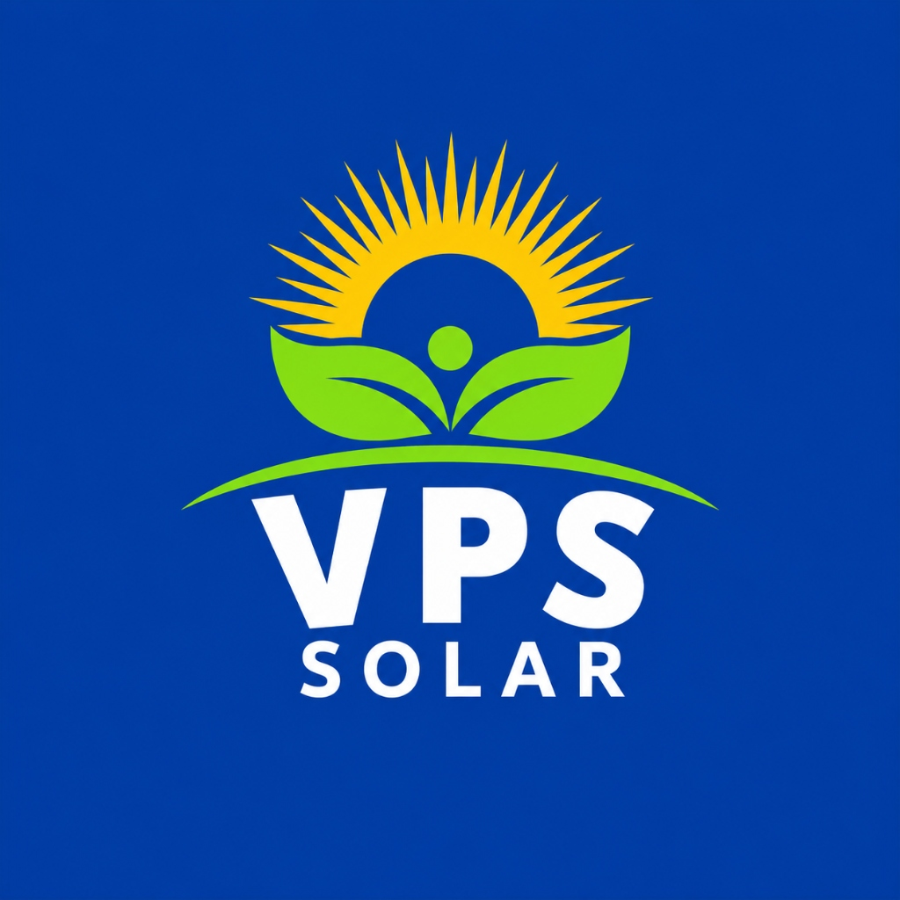

# VIJOY POWER SOLUTION (VPS SOLAR)
## Production-Ready Solar Business Website, CMS & Lead CRM

A enterprise-grade solar energy solutions and solar panel installation platform designed specifically for **Bihar, Jharkhand, and Uttar Pradesh, India**.



---

## 1. Core Architecture

Built as **TWO interconnected applications within ONE Next.js 14 project**:

1. **Premium Public Solar Business Website**:
   - High-conversion lead generation engine.
   - Comprehensive Solar Panel Catalogue spanning **10W to 730W**.
   - Interactive Solar Feasibility & Savings Calculator.
   - PM Surya Ghar: Muft Bijli Yojana national subsidy hub.
   - Verified installation project portfolio & video stories with customer consent.
   - Hierarchical service area coverage (State → District → City).
   - Multi-channel conversion: Consultation forms, direct click-to-call, and pre-filled WhatsApp links.
   - **Strict Non-Ecommerce Policy**: Zero public pricing, shopping carts, or online checkouts. All commercial quotations are provided privately following an engineering site survey.

2. **Unified Admin Suite (`/admin`)**:
   - **Live Analytics Dashboard**: Real-time leads, status funnels, geographic breakdowns, and active jobs from MongoDB.
   - **Complete Lead CRM**: Filterable lead datagrid, pipeline stages, CSV exports, call logs, WhatsApp triggers, and audit timelines.
   - **Visual Pipeline Funnel**: Kanban board tracking leads from New Discovery to Won Customer.
   - **Follow-up Management**: Categorized tasks (Today, Upcoming, Overdue, Completed) with outcome recording.
   - **Rooftop Site Survey Manager**: Feasibility evaluations, shadow analysis observations, and suggested system capacity.
   - **Private Internal Quotations**: Itemized commercial quotes with GST, PM Surya Ghar subsidy estimations, and approval workflows.
   - **Installation Job Workflow**: Internal EPC progression from material procurement to DISCOM net-metering synchronization.
   - **Full CMS Engine**: Homepage CMS, Page editor, Solar catalogue CMS (10W-730W), Solutions, Services, FAQs, Testimonials with consent controls, and Knowledge Hub.
   - **Cloudinary Media Library**: Centralized asset organizer with upload signatures and in-use deletion protection.
   - **Role-Based Access Control (RBAC)**: Super Admin, Admin, Sales Manager, Sales Executive, Installation Manager, Technician, Content Editor, Viewer.
   - **Security Audit Logs**: Immutable recording of authentication and stage change events.

---

## 2. Tech Stack

- **Framework**: Next.js 14 (App Router) + TypeScript + React 18
- **Styling**: Tailwind CSS with custom design system:
  - Deep Navy Blue: `#102A43`
  - Solar Green: `#16803C`
  - Solar Yellow: `#F6C453`
  - Light Green: `#EAF5ED`
  - Slate Muted: `#667085`
- **Database**: MongoDB Atlas / Local MongoDB with Mongoose ODM
- **Media Management**: Cloudinary API with signed client uploads
- **Authentication**: Signed edge-compatible session tokens (`jose` JWT) + Argon2/Bcrypt password hashing + HttpOnly cookies
- **Validation**: Zod (with Indian 10-digit mobile number validation `/^[6-9]\d{9}$/` and anti-spam honeypot)
- **Transactional Notifications**: Nodemailer SMTP with graceful local fallback logging
- **Icons**: Lucide React
- **Testing**: Node.js test runner covering Zod schemas, auth, calculator formulas, and RBAC matrices

---

## 3. Getting Started

### Prerequisites
- Node.js 18.x, 20.x, or 22.x
- MongoDB (local instance or MongoDB Atlas connection string)

### Installation
```bash
# Clone the repository
git clone <repo-url>
cd "Vijay Power Solution"

# Install dependencies
npm install

# Copy environment template
cp .env.example .env
```

### Environment Configuration (`.env`)
```ini
# Application URL
NEXT_PUBLIC_APP_URL="http://localhost:3000"

# MongoDB Database URI
MONGODB_URI="mongodb://127.0.0.1:27017/vijoy_power_solution"

# Auth Session Secret
JWT_SECRET="vps_solar_ultra_secure_jwt_secret_key_minimum_32_chars_2026"

# Initial Super Admin Seed Credentials
SUPER_ADMIN_NAME="Er. Vijoy Kumar"
SUPER_ADMIN_EMAIL="admin@vijoypowersolution.com"
SUPER_ADMIN_PASSWORD="Admin@VPS2026SolarSecure!"

# Cloudinary Media Configuration
CLOUDINARY_CLOUD_NAME="your-cloud-name"
CLOUDINARY_API_KEY="your-api-key"
CLOUDINARY_API_SECRET="your-api-secret"

# Transactional Mail (Optional - logs locally if unset)
SMTP_HOST="smtp.example.com"
SMTP_PORT="587"
SMTP_USER="notifications@vijoypowersolution.com"
SMTP_PASS="your-smtp-password"
ADMIN_NOTIFICATION_EMAIL="contact@vijoypowersolution.com"
```

### Database Seeding
Populate initial service areas (Bihar, Jharkhand, UP), 10W-730W product catalogue, solar solutions, installation services, verified case studies, and bootstrap the Super Admin:
```bash
npm run seed
```

### Run Development Server
```bash
npm run dev
```
Open [http://localhost:3000](http://localhost:3000) for the public website.
Access the unified admin portal at [http://localhost:3000/admin/login](http://localhost:3000/admin/login).

Default Super Admin Login:
- **Email**: `admin@vijoypowersolution.com`
- **Password**: `Admin@VPS2026SolarSecure!`

---

## 4. Automated Testing
Run the comprehensive test suite verifying validations, permissions, and business formulas:
```bash
npm test
```

---

## 5. Production Build & Deployment

### Production Compilation
```bash
npm run build
npm start
```

### Deployment on Vercel
1. Push repository to GitHub/GitLab.
2. Import project into Vercel.
3. Configure Environment Variables (`MONGODB_URI`, `JWT_SECRET`, `NEXT_PUBLIC_APP_URL`, `CLOUDINARY_*`).
4. Set build command: `npm run build` and output: `.next`.

### Deployment on Linux VPS (Hostinger, AWS, DigitalOcean)
1. Install Node.js 20+ and PM2:
   ```bash
   sudo npm install -g pm2
   ```
2. Run build and start with PM2:
   ```bash
   npm run build
   pm2 start npm --name "vps-solar" -- start
   pm2 save
   pm2 startup
   ```
3. Configure NGINX reverse proxy to port `3000` with SSL via Let's Encrypt Certbot.
